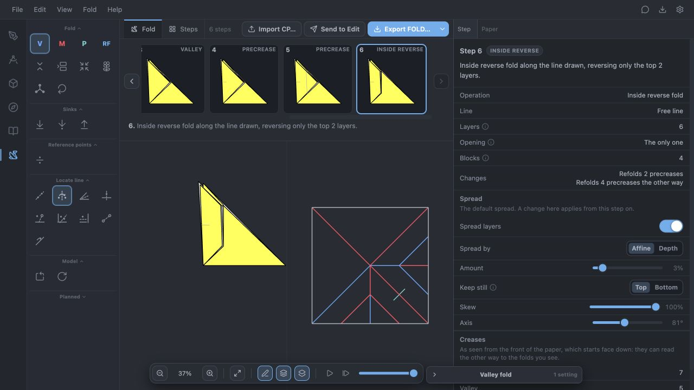
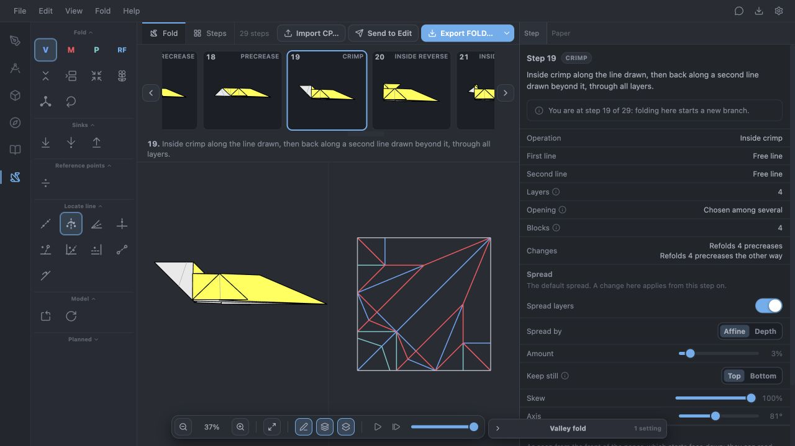

# Nested reverse and boundary crimp implementation — 2026-10-14

The two confirmed in-scope implementation priorities, F030 and F039, are resolved locally. New diagram authoring is paused. This work upgrades existing examples only; it adds no new completed tutorial to the campaign count.

| Existing model | Saved position | Change | Reference |
| --- | --- | --- | --- |
| [Dove native file](../../2026-10-13-origami-fold-trials/models/in-progress/dove.osf) | Source 6 / Fold 6; 7 nodes, 8 states | Direct inside reverse of both nested flap pairs. The remainder of the tutorial is unattempted. | [Tutorial](https://origami.me/dove/) |
| [Squirrel native file](../../2026-10-13-origami-fold-trials/models/completed/squirrel.osf) | Complete through source 26 / Fold 29; 34 nodes, 35 states | Source 16 / Fold 19 is a direct Crimp, replacing its saved CP workaround. | [Tutorial](https://origami.me/squirrel/) |

Both files open in Fold with saved operations and opening choices. Squirrel remains ready for user audit; Dove is a verified prefix in progress. Neither is marked user-approved. The tutorials' earlier source reviews and stated proportion choices still apply. This change does not add cuts, assembly or non-flat behavior.

## F030: nested openings

The previous reverse operation kept absolute layer order between different flaps, even when their corresponding upper and lower halves needed to turn together. The new rule recognizes selected nested openings on a common spine, using actual moving-side overlap and consistent opposite upper/lower nesting. Explicit pairs of corresponding halves carry their order through the shared motion. Opposite halves, unrelated openings and each opening's stationary pocket walls retain their constraints.

The coupling is pairwise: sibling pockets are not merged transitively through an enclosing flap. Existing block identities, saved opening witnesses, animation reports and the completion solver stay intact. Crimps use the same relationship within their strip and tip blocks. Fold's behavior version is now 2, invalidating stale replay caches.

The exact Dove source-5 prefix and depth-two request previously returned `reverse_kind_infeasible`. It now matches the independently verified CP control in material transforms, exposed sides and full ordered stacks. Selecting only the outer pair still refuses `reverse_tip_not_free`; an unselected nested flap is not allowed to be crossed.

## F039: exact boundary contact

The crimp's two hinges may meet at an exact packet boundary endpoint if every remaining first-hinge contact lies clear of the second line on the same side, with a nondegenerate strip. Interior crossings, coincident hinges and sub-minimum near misses still refuse. The second scoring pass and all final geometry, contact and layer checks remain in force.

Squirrel's exact source-16 request previously returned `crimp_lines_meet`. It now produces the intended two-reflection neck motion. Its direct result and all 13 subsequent saved states match the previous independently checked CP continuation at full material-stack witnesses. The authoring recipe now uses the direct crimp as well.

## UI and saved-file audit

- Dove: selected the existing crease, swapped to the tip side, selected the two nested front flaps while leaving the back flap stationary, and committed Inside reverse fold. The result has four motion blocks and matches the checked front trapezoid and concealed tip.
- Squirrel: picked both existing neck creases in Crimp, selected the middle opening (2 of 3), and committed Inside crimp. Both lines share the boundary endpoint. The saved direct crimp and final Squirrel were inspected in Fold.
- The unchanged source prefixes retain their prior all-state visual audits. The changed operations were checked again in Fold; material correspondence checks carry the Squirrel audit through all later states. Fresh replay checks every saved state.
- Test-only UI branches were not saved over the native files. The canonical files were migrated through guarded generators, then reopened through the normal project reader.

UI commits: [Dove](dove-direct-reverse-tool.png), [Squirrel](squirrel-direct-crimp-tool.png). [Squirrel final result](squirrel-direct-crimp-final.png).

## Validation

- Both exact reproductions were observed failing before the fixes. Rust fixtures retain their independent CP controls and explicit opening choices.
- `cargo test -p oristudio-fold -p oristudio-fold-wasm`: 433 tests passed. The final focused bridge run also passes the added Dove outer-only refusal regression.
- `FLATFOLDER_ORACLE=tools/flat-folder-oracle/oracle.mjs cargo test -p oracle-tests --test fold_compound_oracle`: all 3 tests passed, including the enabled Flat-Folder verification and seeded Oriedita cases.
- Rebuilt the Fold WASM bridge with behavior version 2. Four focused web/WASM suites passed, 22 tests covering direct requests, tool analysis, serialization, fresh replay and compound motion.
- Web typecheck and focused ESLint passed. Rust format and affected-crate clippy completed successfully. Clippy emitted the checkout's existing unknown-lint warning for `chunks_exact_to_as_chunks`; no source diagnostic was introduced.
- Both migrated projects freshly replay all 43 states. Squirrel's updated authoring recipe also passes its material, stationary-order, pocket-order and arm-alignment checks.
- Read-only campaign replay: **49 active native files, 694 nodes, 743 states**, all successful and all available recorded hashes match. [Results](direct-compound-campaign-replay-2026-10-14.json).
- [Migration comparisons](direct-compound-upgrades-2026-10-14.json) and [native preservation check](direct-compound-preservation-2026-10-14.json): 69 pre-existing native files checked; only Dove and Squirrel changed. Both original byte sequences are archived under `models/archive/checkpoints/*-before-direct-compound.osf`. The other 67, including Heart and Cicada, are unchanged.
- `git diff --check` passed. Full unrelated Rust workspace, desktop packaging and production bundle checks were not run: this change is confined to the original Fold compound engine, its tests and local research artifacts. The affected engine, bridge and browser paths were exercised directly. No ported solver or serializer behavior changed.

Command logs are under `artifacts/nested-reverse-crimp/`. Implementation: [plan](../../../implementation-plans/nested-reverse-boundary-crimp.md). No PR or push.

## Remaining priority

F030 and F039 no longer block direct tooling. The remaining recorded in-scope compound cases, starting with Bird F033 and Witch Hat F032, need correct material/crease correspondence established before more implementation is justified. They are investigations, not confirmed missing primitives. Keep new diagrams paused, retain exact failed attempts, and avoid speculative generalized-fold changes. Source-note UI remains deferred at the user's request.
