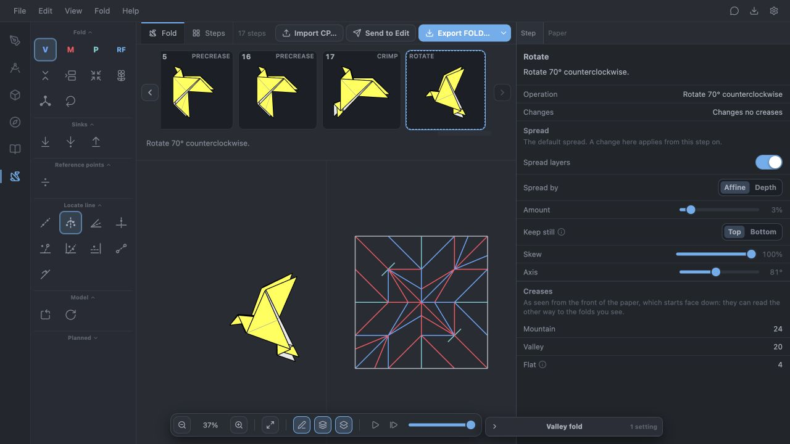

# Dove completion — 2026-10-14

[Native editable model](../../2026-10-13-origami-fold-trials/models/completed/dove.osf) · [Source tutorial](https://origami.me/dove/)

The existing Dove now completes all 16 source instructions: **17 numbered folds, 23 nodes, 24 states**, ready for user audit. The final source rotation is included. The optional spatial tail styling is omitted; the tutorial's flat endpoint is retained.

The direct back-side reverse at Fold 10 uses the same two nested-pair support as source 6. The beak uses the central balanced opening, and the two wings move individually. Fold 17 uses the direct inside crimp, with two nested openings and hinges meeting at their shared boundary endpoint. Selecting all layers would also move the wings and is wrong; selecting only the outer tail pair is blocked. Depth two selects the two intended tail pairs. No guard was relaxed for these inputs.

The beak proportion is explicitly chosen: its crease joins the point 10% along the upper diagonal to the right-edge midpoint. Tail precreases use Segment extent so the line stops at the wing junction. These and all opening choices are saved in the native sequence.

## Verification

- All 24 states replay identically from a fresh engine.
- Both new reverse operations and the tail crimp pass 76 original-sheet material/side checks and 988 stationary layer-order pair checks.
- Five new precreases preserve the complete material stacks (59 witnesses).
- The tail moves by the intended two reflections; the wings and head stay put. Visible paper remains front-colored.
- Every new saved state was inspected in the normal Fold workspace against the source diagrams; the earlier source-6 prefix retains its previous audit.
- The seven-node input is archived as `archive/checkpoints/dove-before-completion.osf`. Every other pre-existing native file is unchanged; see [preservation check](dove-completion-preservation.json).

[Replay and material checks](dove.validation.json) · [Exact operations](dove.operations.json) · [Reproduction](../dove-completion.mjs) · [Verification script](../dove-completion-checks.mjs)

No additional engine changes were necessary. The next requested work is planning history-based reversible steps; the remaining Bird/Witch investigations remain open, and no new diagram was started.
